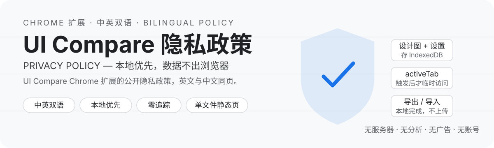
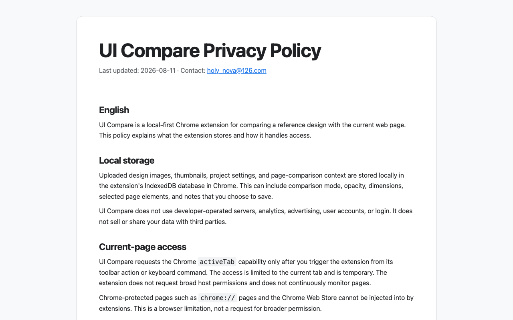

<p align="right"><a href="README.md">中文</a></p>

<p align="center">
  
</p>

<p align="center">
  <a href="https://xiaosang.cc/ui-compare-privacy-policy/">▶ View Policy</a>
  ·
  <a href="https://github.com/holynova/ui-compare-privacy-policy">GitHub Repository</a>
</p>

This repository hosts the public bilingual privacy policy for the UI Compare Chrome extension — a local-first tool for comparing a reference design with the current web page. The policy explains what the extension stores and how it handles page access. Last updated: 2026-08-11.

## Screenshot

<p align="center">
  
</p>

## Policy Highlights

The full policy is in [`index.html`](./index.html), English first and Chinese second, in 5 sections:

- **Local storage**: design images, thumbnails, project settings, and comparison context (comparison mode, opacity, size, selected element, notes) live in the extension's own IndexedDB in Chrome. No developer servers, analytics, advertising, accounts, or login; no data sold or shared with third parties.
- **Current-page access**: the `activeTab` capability is requested only after you click the toolbar button or trigger a keyboard command; it is limited to the current tab and temporary. No broad host permissions, no continuous monitoring. Chrome-protected pages (`chrome://`, Web Store) cannot be injected — a browser limitation.
- **Export and import**: archive export/import is user-initiated and completed locally; nothing is uploaded to cloud services or developer servers.
- **Retention and deletion**: local projects stay in extension storage until you delete them, clear local data, or uninstall the extension; archive files on your device are yours to keep or delete.
- **Contact**: privacy questions to holy_nova@126.com.

## This Site

- A single-file static page (`index.html`, no build, no dependencies) — just open it.
- This site contains no analytics, advertising, account login, or data collection services.

```
index.html        Full policy text (English + Chinese, inline styles)
screenshot.png    Page screenshot
```
