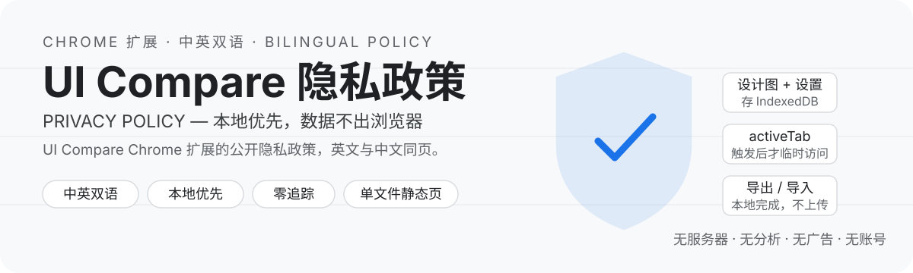
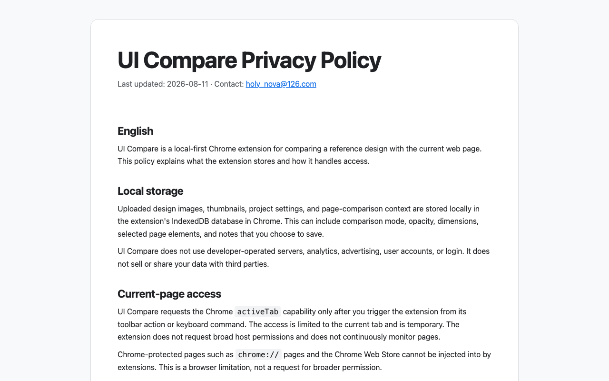

<p align="center">
  
</p>

<p align="center">
  <a href="https://xiaosang.cc/ui-compare-privacy-policy/">▶ 查看政策 View Policy</a>
  ·
  <a href="https://github.com/holynova/ui-compare-privacy-policy">GitHub 仓库</a>
</p>

这是 UI Compare Chrome 扩展的公开隐私政策页，中英双语同页。UI Compare 是一款本地优先的扩展，用于比较参考设计与当前网页；本政策说明扩展保存哪些内容、如何处理页面访问。最后更新：2026-08-11。

This repository hosts the public bilingual privacy policy for the UI Compare Chrome extension — a local-first tool for comparing a reference design with the current web page. The policy explains what the extension stores and how it handles page access. Last updated: 2026-08-11.

## 截图 / Screenshots

<p align="center">
  
</p>

## 政策要点 / Policy Highlights

政策全文在 [`index.html`](./index.html)，英文在前、中文在后，共 5 节：

- **本地存储**：设计图、缩略图、项目设置与比较上下文（比较模式、不透明度、尺寸、选中元素、备注）保存在 Chrome 扩展自己的 IndexedDB 里。不用开发者服务器、分析、广告、账号或登录；不向第三方出售或共享数据。
- **当前页面访问**：只在用户点工具栏按钮或触发键盘命令后，才请求 Chrome 的 `activeTab` 能力；仅限当前标签页、临时有效。不申请广泛主机权限，不持续监控页面。`chrome://` 页面与 Chrome Web Store 等受保护页面无法注入（浏览器限制）。
- **导出和导入**：归档导出/导入由用户主动发起、在本地完成，不上传到云服务或开发者服务器。
- **保存期限与删除**：本地项目保留在扩展存储中，直到用户删除、清除本地数据或卸载扩展；设备上的归档文件由用户自行决定保留或删除。
- **联系**：隐私问题请联系 holy_nova@126.com。

## 本站 / This Site

- 单文件静态页（`index.html`，无构建、无依赖），直接打开即可看。
- 本站不含分析、广告、账号登录或数据收集服务。

```
index.html        政策全文（英文 + 中文，内联样式）
screenshot.png    页面截图
```

## English

**UI Compare Privacy Policy** — the public bilingual (English + Chinese) privacy policy for the UI Compare Chrome extension, a local-first tool for comparing a reference design with the current web page.

- **Local storage**: design images, thumbnails, project settings, and comparison context live in the extension's own IndexedDB in Chrome. No developer servers, analytics, advertising, accounts, or login; no data sold or shared with third parties.
- **Current-page access**: the `activeTab` capability is requested only after you trigger the extension, is limited to the current tab, and is temporary. No broad host permissions, no continuous monitoring. Chrome-protected pages (`chrome://`, Web Store) cannot be injected — a browser limitation.
- **Export/import**: user-initiated local actions; archives never leave your device.
- **Retention**: local projects stay until you delete them, clear extension data, or uninstall.
- **Contact**: holy_nova@126.com. Last updated: 2026-08-11.
- **This site**: a single static HTML file, no build, no dependencies, no analytics or tracking.
